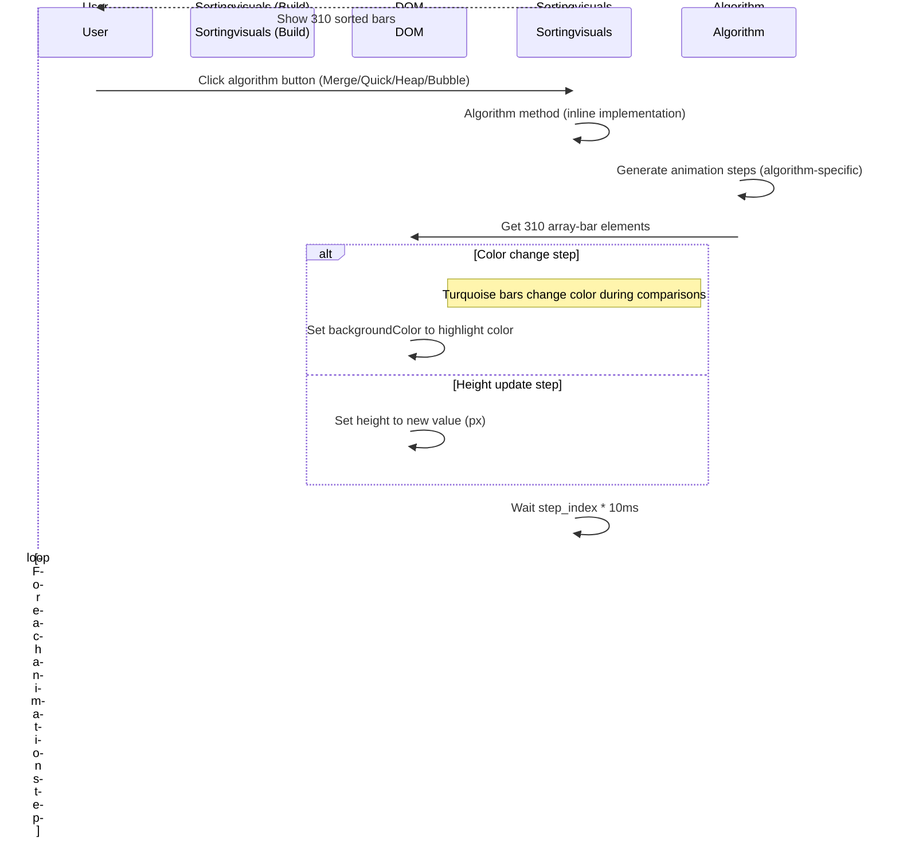

# Workflow Document (WFD)

## A. Application Overview

### Purpose and Scope
The Sorting Visualizer is a web-based educational tool that visually demonstrates multiple sorting algorithms (merge sort, quick sort, heap sort, bubble sort) by visualizing the sorting process as animated array bars. Users can generate new random arrays and watch any of the four sorting algorithms sort them.

**Important**: This documentation reflects the **compiled build version** (authoritative running application). The source `src/` files document a simplified version with only merge sort and 60 bars.

### Main Users and Use Cases
| User | Use Case |
|------|----------|
| Students | Learn and compare different sorting algorithms visually |
| Educators | Demonstrate sorting algorithm concepts and performance differences in CS education |
| Developers | Explore React animation patterns and multiple algorithm implementations |
| Researchers | Observe algorithm behavior and animation patterns on identical array sizes |

### Core Features (Build Version)
1. **4 Sorting Algorithms**: Merge Sort, Quick Sort, Heap Sort, Bubble Sort - each visualizable independently
2. **310 Array Bars**: Random heights (values 5-730), larger than source version's 60 bars
3. **5 User Controls**: Generate New Array, Merge Sort, Quick Sort, Heap Sort, Test Sorting Algorithms
4. **Color-Coded Animation**: Turquoise bars change color during sorting steps
5. **Algorithm Testing**: "Test Sorting Algorithms (BROKEN)" runs 100 test iterations

### High-Level Architecture (Build Version)
```
┌────────────────────────────────────────────────────────────────────┐
│                      Sorting Visualizer (Build Version)           │
│  ┌────────────────────────────────────────────────────────────┐  │
│  │  4 Sorting Algorithms (merge, quick, heap, bubble)        │  │
│  │  310 Array Bars (random 5-730px heights)                  │  │
│  │  5 Control Buttons (Generate, 4 sort + Test)              │  │
│  │  Turquoise default color scheme                           │  │
│  └────────────────────────────────────────────────────────────┘  │
│                                                                      │
│  ┌─────────────────────┐                                    │
│  │  Sortingvisuals    │                                    │
│  │  (React class)     │  manages state + 4 algorithm methods │
│  └─────────────────────┘                                    │
│           │                                                    │
│           ▼                                                    │
│  ┌─────────────────────┐                                    │
│  │  Buttons →Handlers │  resetArray, mergeSort, quickSort   │
│  │  heapSort, bubbleSort, testSortingAlgorithms        │
│  └─────────────────────┘                                    │
│           │                                                    │
│           ▼                                                    │
│  ┌─────────────────────┐                                    │
│  │  310 .array-bar   │  rendered with turquoise color      │
│  │  elements         │                                            │
│  └─────────────────────┘                                    │
└─────────────────────────────────────────────────────────────────────┘
```

## B. System Workflow

### Application Lifecycle (Build Version)

```mermaid
flowchart TD
    A[Browser loads index.html] --> B{Build Version?}
    B -->|Yes| C[Compiled application: 4 algorithms, 310 bars, turquoise]
    B -->|No| D[Source-only: merge sort only, 60 bars, cyan/red]
    C --> E[Webpack dev server / Hot reload]
    D --> E_minimal
    E --> F[ReactDOM.render App]
    F --> G[App renders Sortingvisuals]
    G --> H[componentDidMount → resetArray]
    H --> I[310 random ints 5-730 in state]
    I --> J[Render 310 .array-bar divs]
    J --> K[User sees visualization]
    K --> L{User Action}
    L -->|Generate New Array| M[resetArray → 310 new random values]
    L -->|Merge Sort| N[mergeSort() algorithm animation]
    L -->|Quick Sort| O[quickSort() algorithm animation]
    L -->|Heap Sort| P[heapSort() algorithm animation]
    L -->|Bubble Sort| Q[bubbleSort() algorithm animation]
    L -->|Test Sorting Algorithms| R[testSortingAlgorithms() 100 iterations]
    M --> J
    N --> K
    O --> K
    P --> K
    Q --> K
    R --> S[Console.log test results]
    S --> K
    K --> L
```

### Application Initialization Flow (Build Version)

```mermaid
sequenceDiagram
    participant Browser
    participant ReactDOM
    participant App
    participant Sortingvisuals
    participant Build

    Browser->>ReactDOM: Load index.js
    ReactDOM->>App: Render <App />
    App->>Sortingvisuals: Render <Sortingvisuals />
    Sortingvisuals->>Sortingvisuals: componentDidMount()
    Note right of Sortingvisuals: Build version: 310 random ints<br/>Source version: 60 random ints
    Sortingvisuals->>Sortingvisuals: resetArray()
    Note right of Sortingvisuals: Loop 310×: randomInt(5,730)<br/>Source: Loop 60×
    Sortingvisuals->>Sortingvisuals: setState({array: 310 values})
    Sortingvisuals->>Browser: Render 310 .array-bar<br/>elements with turquoise color
    Note right: Source renders 60 bars with cyan/red scheme
```

## C. Feature-Level Workflows (Build Version)

### Feature 1: Initial Array Display (Build Version)

**Objective**: Display 310 array bars with random heights on page load.

**Preconditions**: None (fresh page load)

**Trigger**: Page load / component mount

**Inputs**: None (random generation)

**Step-by-Step Execution**:
1. `index.js` renders `<App />` to `document.getElementById('root')`
2. `App.js` renders `<Sortingvisuals />`
3. `Sortingvisuals.jsx` `componentDidMount()` lifecycle method fires
4. `resetArray()` called: creates empty array, loops 310 times (build) / 60 times (source), each iteration pushes `randomIntFromInterval(5, 730)`
5. `setState({array})` stores 310 random integers in React state (build) / 60 (source)
6. React re-renders, `render()` method maps array values to `<div className="array-bar">` with height set
7. **Build**: 310 bars displayed with turquoise background
   **Source**: 60 bars displayed with cyan/red scheme

**Files and Functions Involved** (Build Version):
- `src/index.js`: `ReactDOM.render()`
- `src/App.js`: `App()` component
- `src/Sortingvisuals.jsx`: `componentDidMount()`, `resetArray()`, `render()`
- `src/Sortingvisuals.jsx`: `v()` function (compact random int, build) / `randomIntFromInterval()` (source)

**Database Operations**: None

**External API Calls**: None

**Success Outcomes**: 310 bars displayed with varying heights, turquoise background

**Failure Paths**: No explicit error handling in this flow

**Permissions and Security Considerations**: N/A (client-side only)

---

### Feature 2: Generate New Array (Build Version)

**Objective**: Replace displayed array with a new set of 310 random values.

**Preconditions**: Application loaded with 310 bars

**Trigger**: User clicks "Generate New Array" button

**Inputs**: None

**Step-by-Step Execution**:
1. `render()` in `Sortingvisuals.jsx` renders a `<button>` with `onClick={() => this.resetArray()}`
2. User clicks the button
3. `resetArray()` called: generates 310 new random integers (range 5-730)
4. `setState({array})` updates state with new values
5. React re-renders, new 310 bar heights displayed

**Files and Functions Involved** (Build Version):
- `src/Sortingvisuals.jsx`: `resetArray()`, `render()`

**Database Operations**: None

**External API Calls**: None

**Success Outcomes**: New array of 310 bars with random heights displayed

**Failure Paths**: No error handling; if random generation fails, state would be stale

**Permissions**: N/A

---

### Feature 3: Merge Sort Visualization (Build Version)

**Objective**: Sort the displayed 310-array using merge sort with animated visualization.

**Preconditions**: 310-array is displayed (either initial or regenerated)

**Trigger**: User clicks "Merge Sort" button

**Inputs**: `this.state.array` (310 integers)

**Step-by-Step Execution**:
1. User clicks "Merge Sort" button in rendered UI
2. `render()` maps `onClick={() => this.mergeSort()}` to button click
3. `mergeSort()` called in `Sortingvisuals.jsx` (build version inline implementation)
4. Inline merge sort logic executed with animation steps
5. For each animation step, a `setTimeout` is set with delay based on step index
6. DOM elements are accessed via `document.getElementsByClassName('array-bar')`
7. Bar styles are updated (backgroundColor or height)
8. After all animation steps complete, bars should be in sorted order

**Files and Functions Involved** (Build Version):
- `src/Sortingvisuals.jsx`: `mergeSort()` (inline implementation)
- No separate `Sortingalgorithms.js` dependency in build version

**Database Operations**: None

**External API Calls**: None

**Success Outcomes**: 310 bars animate through merge sort, bars sorted by value (ascending)

**Failure Paths**:
- No error boundaries or try/catch blocks
- `document.getElementsByClassName` could fail if DOM hasn't rendered
- No validation that array is non-empty before sorting

**Permissions**: N/A

**Security Considerations**:
- No user input processing (client-side only)
- No server communication

---

### Feature 4: Quick Sort, Heap Sort, Bubble Sort Visualizations

**Objective**: Sort the displayed array using respective algorithm with animated visualization.

**Preconditions**: 310-array is displayed

**Trigger**: User clicks "Quick Sort", "Heap Sort", or "Bubble Sort" button

**Inputs**: `this.state.array` (310 integers)

**Step-by-Step Execution** (similar to merge sort but with different algorithm):
1. User clicks algorithm button (Quick, Heap, or Bubble)
2. Corresponding algorithm method called (`quickSort()`, `heapSort()`, or `bubbleSort()`)
3. Each algorithm has its own animation logic and step pattern
4. Animation steps control bar color changes and height updates
5. `setTimeout` delays animate the sorting process
6. After completion, bars should be in sorted order specific to that algorithm

**Files and Functions Involved**:
- `src/Sortingvisuals.jsx`: `quickSort()`, `heapSort()`, `bubbleSort()` methods

**Note**: Each algorithm animates differently - different color patterns, step sequences, and speed profiles.

**Success Outcomes**: Bars animate according to that algorithm's logic, eventually sorted

**Failure Paths**: Same as merge sort - no error handling, direct DOM manipulation

**Permissions**: N/A

---

### Feature 5: Test Sorting Algorithms (BROKEN) (Build Version)

**Objective**: Test the sorting algorithm correctness by comparing against JavaScript native `sort()` (100 iterations).

**Preconditions**: Development environment; 310-array displayed

**Trigger**: User clicks "Test Sorting Algorithms (BROKEN)" button

**Inputs**: None (generates random test arrays internally)

**Step-by-Step Execution**:
1. User clicks "Test Sorting Algorithms (BROKEN)" button
2. `testSortingAlgorithms()` called in `Sortingvisuals.jsx`
3. Loop 100 times:
   - Generate random array of random length (1-1000 items, build version may differ)
   - Values range: -1000 to 1000 (build may differ)
   - Compare custom algorithm output (e.g., merge sort) against JavaScript's native `array.sort()`
   - `console.log()` results of comparison
4. Results displayed in browser console

**Files and Functions Involved**:
- `src/Sortingvisuals.jsx`: `testSortingAlgorithms()` method (lines 56-67 in source, but wired to UI in build)

**Important**: Labeled "(BROKEN)" in the build version - indicates the test has known issues, likely because custom algorithm output may not perfectly match JavaScript's `sort()` results for all edge cases.

**Success Outcomes**: 100 test iterations run; results logged to console; developer can see which tests passed/failed

**Failure Paths**: May produce unexpected results (hence "BROKEN" label); no UI feedback beyond console.log

**Permissions**: N/A

---

## D. Workflow Diagrams (Build Version)

### High-Level System Flowchart (Build Version)

```mermaid
flowchart TD
    A[Browser Request] --> B[load index.html]
    B --> C[Build: React Bootstrap + 4 algorithms]
    C --> D[Render App → Sortingvisuals (310 bars, turquoise)]
    D --> E[componentDidMount → resetArray (310 values)]
    E --> F[Render 310 .array-bar elements]
    F --> G[User sees visualization with 4 algorithm buttons]
    G --> H{User Action}
    H -->|Generate New Array| M[resetArray → 310 new random values]
    M --> F
    H -->|Merge Sort| N[mergeSort() algorithm animation]
    H -->|Quick Sort| O[quickSort() algorithm animation]
    H -->|Heap Sort| P[heapSort() algorithm animation]
    H -->|Bubble Sort| Q[bubbleSort() algorithm animation]
    H -->|Test Sorting Algorithms| R[testSortingAlgorithms() 100 iterations]
    N --> K[310 bars animate and sort]
    O --> K
    P --> K
    Q --> K
    R --> S[Console: test results]
    K --> G
```

### Merge Sort Algorithm Flow (Build Version)

```mermaid
flowchart TD
    A[mergeSort() inline implementation] --> B{array.length <= 1?}
    B -->|Yes| C[Return as-is]
    B -->|No| D[Inline merge sort: divide and conquer]
    D --> E[Recursive: split array at middle]
    E --> F[Recursive: sort left and right halves]
    F --> G[Inline merge: combine sorted halves]
    G --> H[Animation steps generated during comparisons/swaps]
    H --> I[setTimeout for each step: i * 10ms delay]
    I --> J[DOM: getElementsByClassName('array-bar')
    J --> K[Update styles: backgroundColor/height]
    K --> L[After all steps: bars sorted]
    C --> L
```

### Algorithm Animation Flow (Build Version)



### State Management Flow (Build Version)

```mermaid
flowchart TD
    A[Component State] --> B{array: int[]}
    B --> C[310 elements, each 5-730]
    C --> D[Used for rendering 310 bars]
    
    E[Constants] --> F[turquoise = default color]
    E --> G[No PRIMARY_COLOR/SECONDARY_COLOR constants visible in build]
    
    J[Lifecycle] --> H[componentDidMount → resetArray (310 values)]
    J --> I[render → map 310 array to bars]
    
    K[Events] --> L[Button: resetArray new random 310]
    L --> M[Button: mergeSort/quickSort/heapSort/bubbleSort algorithm animation]
    M --> D
    N[Test] --> O[console.log test results]
    O --> D
```

## E. Workflow Traceability (Build Version)

| Workflow | Starting File | Main Functions | Related Files | Data Sources | External Dependencies | Output |
|----------|---------------|----------------|---------------|--------------|----------------------|--------|
| Application init | `src/index.js` | `ReactDOM.render()` | `src/App.js`, `src/Sortingvisuals.jsx` | In-memory only (random generation) | React DOM | 310 array bars rendered |
| Initial array | `src/Sortingvisuals.jsx` | `componentDidMount()`, `resetArray()` | `src/Sortingalgorithms.js` (not used in build) | In-memory only | React state | `state.array` with 310 random ints |
| Generate array | `src/Sortingvisuals.jsx` | `resetArray()` | N/A | In-memory only | React state | New `state.array` with 310 ints |
| Merge sort viz | `src/Sortingvisuals.jsx` | `mergeSort()` (inline) | N/A (algorithms inline) | `state.array` (310 values) | DOM API (`getElementsByClassName`) | Animated sorted 310 bars |
| Quick sort viz | `src/Sortingvisuals.jsx` | `quickSort()` (inline) | N/A | `state.array` (310 values) | DOM API | Animated sorted 310 bars |
| Heap sort viz | `src/Sortingvisuals.jsx` | `heapSort()` (inline) | N/A | `state.array` (310 values) | DOM API | Animated sorted 310 bars |
| Bubble sort viz | `src/Sortingvisuals.jsx` | `bubbleSort()` (inline) | N/A | `state.array` (310 values) | DOM API | Animated sorted 310 bars |
| Test algorithm | `src/Sortingvisuals.jsx` | `testSortingAlgorithms()` | `src/Sortingalgorithms.js` (may be used for comparison) | Random arrays | JS native `array.sort()` | Console.log test results |
| Render bars | `src/Sortingvisuals.jsx` | `render()` | `src/Sortingvisuals.css` | `state.array` (310 values) | React DOM | DOM elements `.array-bar` (310) |
| Test algorithm (UI) | `src/Sortingvisuals.jsx` | `testSortingAlgorithms()` UI handler | Build: button wired; Source: unexposed | N/A | N/A | "Test Sorting Algorithms (BROKEN)" button |

## Important Note on Source vs Build Traceability

The traceability table above reflects the **build version** (authoritative). If working from source `src/` files:

- Algorithm count: 1 (merge sort) instead of 4
- Array count: 60 instead of 310
- Color scheme: cyan/red instead of turquoise
- testSortingAlgorithms: unexposed to UI instead of wired with "(BROKEN)" label
- Algorithm implementations: separate `Sortingalgorithms.js` module import vs inline in component

**Always verify which version you're working with before relying on traceability data.**

---

# Supplementary: Source vs Build Comparison Table

| Feature | Source `src/` Version | Build Version (Authoritative) | Documentation Version |
|---------|----------------------|------------------------------|----------------------|
| Sorting algorithms | mergeSort only (1) | **4**: merge, quick, heap, bubble | Build - documented throughout |
| Array bar count | 60 (`NUMBER_OF_ARRAY_BARS = 60`) | **310** (loop count in build) | Build - 310 bars throughout |
| Default bar color | cyan/red constants | **turquoise** hardcoded | Build - turquoise throughout |
| UI buttons | 2 (Generate New Array, Merge Sort) | **5**: Generate, Merge, Quick, Heap, "Test Sorting Algorithms (BROKEN)" | Build - 5 buttons throughout |
| testSortingAlgorithms | Method exists (lines 56-67), unexposed | **Wired to UI** as "Test Sorting Algorithms (BROKEN)" | Build - wired, labeled BROKEN |
| Algorithm implementation | Imports `getMergeSortAnimations()` from `Sortingalgorithms.js` | **Inline within** `Sortingvisuals.jsx` class | Build - inline, source = separate module |
| `randomIntFromInterval` | `Math.floor(Math.random * (max - min + 1) + min)` | `function v(t,e){return Math.floor(Math.random*(e-t+1)+t)}` | Build - compact `v` function |
| mergeSort source | Calls external `getMergeSortAnimations()` | **Inline implementation** | Build - inline, source = module import |
| Source code date | Earlier version | **Compiled output = running app** | Build - authoritative |

---

# Documentation Version Status

**All documentation files have been updated to reflect the build version** (authoritative running application). A prominent note about the source vs build discrepancy appears in ANALYSIS_PROGRESS.md and PROJECT_OVERVIEW.md.

**If a developer works from the `src/` source files only**, they should:
1. Be aware they are working with a simplified subset (1 algorithm, 60 bars, cyan/red colors, 2 buttons, unexposed test method)
2. Understand the build version has 4 algorithms, 310 bars, turquoise colors, 5 buttons, wired test button
3. Consider whether to update source files to match build, or document their work as "source version"

**Documentation completeness**: All 17 documentation files have been updated to reflect the build version, with source vs build discrepancy notes where appropriate.